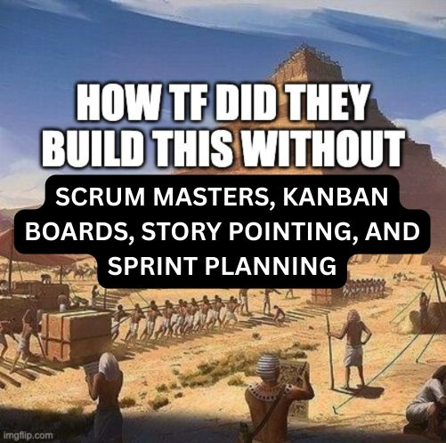

## Cursed Project Management

*An exercise for KnowledgeFest 2026*

We generated 6 projects' worth of tickets, blockers, and chaos. Your goal:

1. **Parachute into your assigned project**
2. **Find the ground truth** by building something with Claude, Claude Code, Codex, or Grok
3. **Then use LLMs to make project management interfaces that are better, faster, funner, or just weirder**

> [!IMPORTANT]
> **BEFORE WE FINISH, ADD your demo in the [shared slide deck](https://docs.google.com/presentation/d/1qWSAZKHwr5Omf9tsD9n-Sz15pPHfcKEG4OT9EiVVJ6g/edit), on your team's slide.** That's what we show on the big screen

### What you need to do

1. Go to **bit.ly/cursed-proj**
2. Find your table number and project in Rolodex
3. Open your project and hit **Copy for AI** (or **Download for Claude Code / Codex**)
4. Paste it into Claude, Codex, (Grok)
5. Build!
6. **Put your demo in the [shared slide deck](https://docs.google.com/presentation/d/1qWSAZKHwr5Omf9tsD9n-Sz15pPHfcKEG4OT9EiVVJ6g/edit), on your team's slide**

### Timing (70 min)

| Time | What |
|---|---|
| 10 min | Explainer |
| 5 min | Move into groups |
| 10 min | Ideate. Protip: have Granola running while you ideate, then dump the notes into the LLM |
| 30 min | Build and submit your Cursed Project Management |
| 5 min | Back to the main room |
| ~10 min | Show and tell: 3–4 teams, as time allows |

### Prompts to get you thinking

* **Better:** Can AI find duplicate tasks for you? Or tasks whose description clashes with their title? How can AI cut the work it takes to diagnose the state of the project? If three tasks are all blocked on each other, show it, Minority Report-style

  

* **Faster:** Tinder, but for your tasks: swipe to do today, defer, or delegate. Cut through the backlog with a virtual chainsaw
* **Funner:** Asana-style celebrations, but with characters in the public domain. Generate a song out of the tasks you completed ([example](https://x.com/anabology/status/2105325733312884869))
* **Weirder:** Destroy costly meetings on the shared calendar with a magic eraser. Put a task in an NCIS-style interrogation room. Have duplicate tasks [eat each other, single-celled-organism style](https://www.youtube.com/watch?v=sq6Y54mxjOg). For inspiration, look up "terrible volume selector UX"

### The projects

| Tables | Project |
| ------ | ------- |
| 1–5 | [PillPrice launch](https://outofpockethealth.github.io/kf-Cursed-proj-mgmt/?board=product-launch): a product launch |
| 6–10 | [Bayberry integration](https://outofpockethealth.github.io/kf-Cursed-proj-mgmt/?board=merger): a platform migration |
| 11–16 | [Fern rollout](https://outofpockethealth.github.io/kf-Cursed-proj-mgmt/?board=ai-rollout): an AI assistant rollout |
| 17–22 | [OOP Navigators day one](https://outofpockethealth.github.io/kf-Cursed-proj-mgmt/?board=onboarding): launching a new 40-person support team |
| 23–28 | [OOP Primary Care opening](https://outofpockethealth.github.io/kf-Cursed-proj-mgmt/?board=credentialing): opening a primary care practice |
| 29–31 | [Larkfield breach response](https://outofpockethealth.github.io/kf-Cursed-proj-mgmt/?board=data-breach): a data breach |
